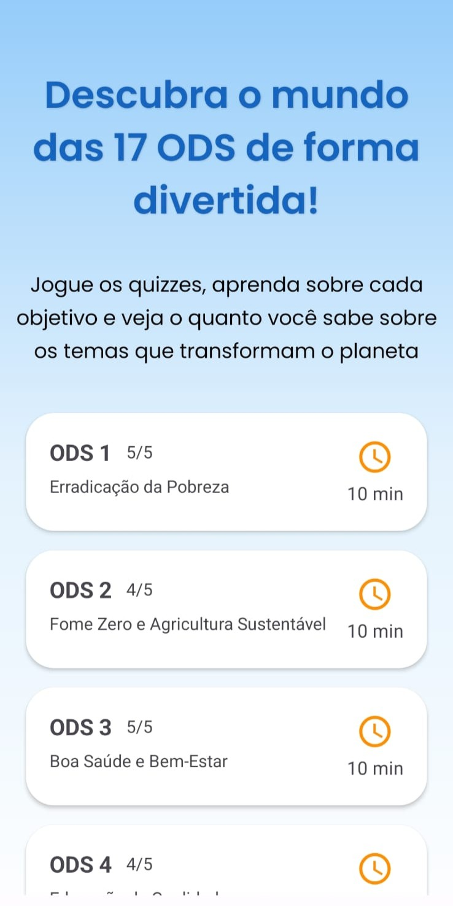
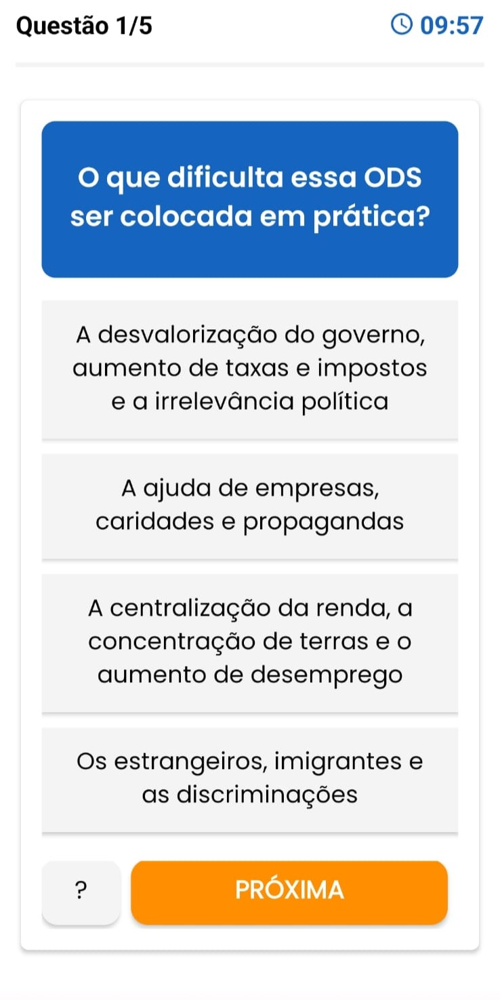
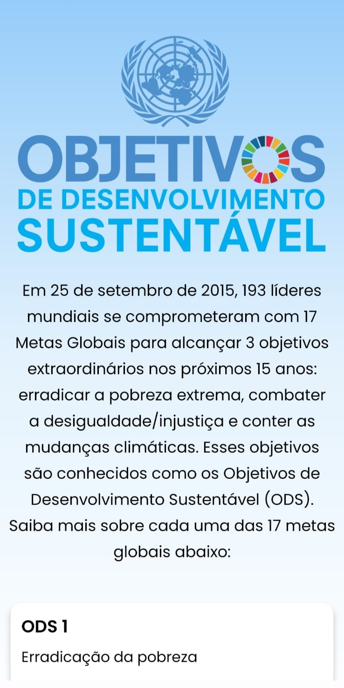

# 🌎 Quiz das ODS

Um aplicativo Android desenvolvido em Kotlin com o objetivo de promover o conhecimento sobre os **17 Objetivos de Desenvolvimento Sustentável (ODS)** estabelecidos pela Organização das Nações Unidas (ONU), por meio de perguntas e respostas interativas.

## 📱 Sobre o projeto

O Quiz das ODS é um aplicativo educativo que permite aos usuários testar seus conhecimentos sobre sustentabilidade, meio ambiente, educação, saúde, igualdade social e outros temas relacionados aos Objetivos de Desenvolvimento Sustentável.

O aplicativo apresenta as 17 ODS em categorias individuais, disponibilizando quizzes de múltipla escolha para tornar o aprendizado mais dinâmico e interativo.

## ✨ Funcionalidades

- Apresentação das 17 categorias correspondentes às ODS.
- Consulta de informações e descrições sobre cada objetivo.
- Carregamento dinâmico das perguntas utilizando Firebase Realtime Database.
- Questões de múltipla escolha com quatro alternativas.
- Verificação de respostas e cálculo de pontuação.
- Cronômetro para controlar o tempo de cada quiz.
- Sistema de dicas para identificar a ODS selecionada.
- Indicador de progresso durante as partidas.
- Armazenamento local das pontuações utilizando SharedPreferences.

## 🛠️ Tecnologias utilizadas

- **Kotlin:** linguagem de programação utilizada no desenvolvimento.
- **Android Studio:** ambiente de desenvolvimento.
- **Firebase Realtime Database:** armazenamento e consulta das perguntas e informações dos quizzes.
- **XML:** construção das interfaces do aplicativo.
- **ViewBinding:** acesso aos componentes das interfaces.
- **RecyclerView:** apresentação dinâmica das listas de categorias.
- **Gradle:** gerenciamento de dependências e compilação.

### Bibliotecas e dependências

- AndroidX Core KTX
- AndroidX AppCompat
- Material Components
- AndroidX Activity
- ConstraintLayout
- Firebase Realtime Database
- JUnit
- Espresso

## ⚙️ Pré-requisitos

Para executar o projeto, é necessário ter:

- Android Studio instalado.
- Android SDK configurado (compileSdk 36).
- JDK 17 ou compatível com a versão do Android Gradle Plugin utilizada.
- Conexão com a internet para sincronização do Gradle e acesso ao Firebase.

## 🚀 Como executar

1. Clone este repositório:

   ```bash
   git clone https://github.com/SEU-USUARIO/quiz-das-ods.git
   ```

2. Abra a pasta do projeto no Android Studio.

3. Aguarde a sincronização do Gradle e o download das dependências.

4. Verifique a configuração do Firebase Realtime Database e do arquivo `google-services.json`.

5. Configure um emulador Android ou conecte um dispositivo físico.

6. Execute o aplicativo pelo botão **Run** do Android Studio.

## 🌱 Objetivos de Desenvolvimento Sustentável

O aplicativo aborda os 17 objetivos:

1. Erradicação da Pobreza
2. Fome Zero e Agricultura Sustentável
3. Saúde e Bem-Estar
4. Educação de Qualidade
5. Igualdade de Gênero
6. Água Potável e Saneamento
7. Energia Limpa e Acessível
8. Trabalho Decente e Crescimento Econômico
9. Indústria, Inovação e Infraestrutura
10. Redução das Desigualdades
11. Cidades e Comunidades Sustentáveis
12. Consumo e Produção Responsáveis
13. Ação Contra a Mudança Global do Clima
14. Vida na Água
15. Vida Terrestre
16. Paz, Justiça e Instituições Eficazes
17. Parcerias e Meios de Implementação

## 📸 Screenshots

### Tela inicial


### Categorias das ODS



### Perguntas do quiz



### Informações sobre as ODS



## 🎯 Finalidade

O projeto tem como finalidade incentivar o conhecimento sobre os Objetivos de Desenvolvimento Sustentável, utilizando a tecnologia como ferramenta de educação e conscientização social e ambiental.

---

**Projeto desenvolvido por Davi Lepera.**
